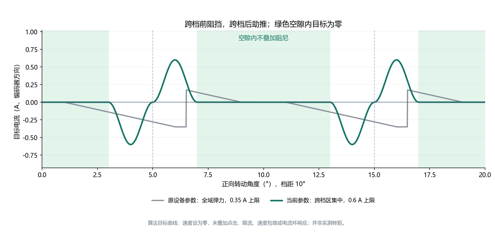

# 2026-11-03 DMA 与力反馈联调

本页前半部分保留 `dma-localized-v1` 的联调历史；后续 `dma-localized-v2` 的低幅振动与瞬态过流修改见文末。当前保护规则以 [USB 协议](protocol.md) 为准。

对象：`D:\kk\esp32\esp32s3-usb-foc`，COM7，ESP32-S3 rev 0.2，MAC `1c:29:04:38:1e:b8`。参考项目为 `D:\kk\stm32\stm32_Cmake_Project\m5-rollercan_smart-knob`。本记录中的电流单位均使用配置的 0.15 V/A 换算，未用外部电流探头复核。

## 对比结论

| 项目 | STM32 参考工程 | 本工程修改前 | 当前实现 |
|---|---|---|---|
| 编码器 | SPI RX/TX DMA，见 `Core/Src/spi.c` | AS5600 I²C 与电流控制串行等待 | 400 kHz I²C，独立 FreeRTOS 任务，带时间戳交接 |
| 电流采集 | ADC 循环 DMA，见 `Core/Src/adc.c` | ADC oneshot 专用忙等路径，2 kHz 控制 | PWM 窗口同步 ADC1 GDMA，5 kHz 控制 |
| 普通档位 | 中心死区 + P 弹力 − D 速度反馈；部分模式另外叠加点击或摩擦补偿 | 中心约 1° 死区，其他区域弹力 + 全域阻尼 | 每档距 60% 区域零目标，跨档区域平滑阻挡/助推，阻尼仅在局部生效 |
| 切档 | `snap_point` 迟滞、持续位置跟踪 | 力矩跟随中心跳变；双向 100 A/s 慢限速 | 力矩周期曲线独立于逻辑迟滞；撤力立即生效，增加幅度 1000 A/s |
| 电流响应 | 独立电流调节路径 | Kp=1.5、Ki=300，无目标电流前馈 | Kp=0.8、Ki=600，约 4.5 Ω 电阻前馈，电压圆内抗饱和 |

参考 `MyFile/src/smart_knob.c:715` 的死区为 `min(档距 × 20%, 1°)`；随后计算 P/D，不是所有档位都只在跨越点附近输出。本轮按用户提出的集中力矩形状重新实现，没有声称照搬参考固件的同一曲线。



图是算法目标，不是实测转矩。旧线使用接入设备原配置：0.35 A、strength=4、damping=0.008、snap=0.65；新线使用 0.6 A、strength=10、damping=0.003、snap=0.55。静态作图不叠加速度包络、点击或电流环响应。脚本：`tools/plot_haptic_profile.py`。

## 实现与实测发现

1. **电流环不再等 I²C。** core 0 编码器任务约 2.5 kHz 更新，单次读取约 203 μs；core 1 电流/手感环约 5 kHz。控制计算、角度变换和热路径放入 IRAM，三角函数使用有桌面数值回归覆盖的范围约化多项式。
2. **ADC 真正使用 GDMA，保持低侧采样条件。** 固定 9 项硬件扫描序列；每次突发前一字丢弃，后两字检查通道、范围、采样时刻，三相轮换，第三相重建。新实现调试中发现 START 低电平过短会漏触发，临时改扫描表会影响预加载的模拟通道；最终分别以 DMA 回调提前清 START、固定硬件扫描序列解决。没有把连续自由采样的数据直接当作有效低侧电流。
3. **力矩集中在跨档区。** 归一化偏移 `u∈[-0.5,0.5)`，`x=clamp((|u|-0.30)/0.20,0,1)`，静态目标为 `-sign(u) × peak × sin²(πx)`。阻尼使用同一区域的平滑包络；空隙内目标为零。有限行程端点、弹簧的恢复语义保留；其回程阻尼单独取 `max(damping, 0.04)`，避免新低阻尼参数在弹簧回中时出现余振。此额外阻尼不用于档位空隙。
4. **补测中速释放很关键。** 早期调参版本在 ±55 rad/s 能正常进入高速暂停并恢复，但 ±30 rad/s 释放后仍可在约 24.5 / 26.0 rad/s 持续转动。只检查“无故障”和“高速暂停恢复”会漏掉这一问题。局部档位助推改为 5–15 rad/s 逐渐收减，保留阻挡半周期；相同 ±30 rad/s 复测的末 500 ms 速度峰值降为 0.288 / 0.240 rad/s，目标回到零。此对比发生在本轮调试版本之间，不是旧固件的严格 A/B。
5. **回弹速度估计。** 2 ms 快速速度滤波在弹簧空载回程中仍留下约 100 Hz 的往复；同一 0.6 A / 2.0 V 配置下，将力反馈速度滤波缩短为 0.5 ms 后，正向释放的末段峰值从 2.689 降到 0.235 rad/s，反向为 0.184 rad/s。10 ms 平滑速度继续用于共同高速包络。桌面测试要求反向反馈在 1 ms 内换向。
6. **删除不必要的主机依赖。** 默认 `KNOB_HOST_LEASE_MS=0`，显式使能后无需持续查询；保留可选租约。普通过流确认改为累计 2000 μs，避免从 2 kHz 提到 5 kHz 后把同样的保护缩短到原来的 40%。采样窗口、编码器有效性和绝对过流限值保留，因为它们决定电流反馈是否可信。

S3 当前启用的数据外设中，ADC 已接入 GDMA。AS5600 使用 I²C；S3 I²C、MCPWM、原生 USB Serial/JTAG 不提供可直接替换为相同 GDMA 通路的接口。可选 UART0 并非本轮启用/测试的传输。硬件 MCPWM 继续自主输出，I²C 等待移出控制任务。

后续手拨测试在 0.8 A / 2.35 V 调参阶段捕获一次 1.62 A 重建相电流并停机。最终参数收敛为 0.6 A / 2.0 V，局部助推改为从静止起按速度递减、10 rad/s 归零，以降低低速往复中的补能。1.25 A 绝对过流保护没有调高。

## 用户反馈与参考修复提交

用户在 `manual-haptics-4.jsonl` 体验后确认“挡位清楚了，手感提升了不少”，但整个转动过程仍有低幅振动，并指出参考提交 `4e0f1bfbed05ec23e9d892388098361700bbe652`（Fixed the jittering issue）。对该提交逐项检查：

- 参考修复移除 SmartKnob 的 0.09 A / 60 mA 幅值硬死区，保留小电流连续性。本实现没有该幅值硬死区，不能把两者直接判为同一根因。
- 参考修复只允许无边界模式慢移中心；本实现没有 idle 追随中心的逻辑。
- 参考固件在严格零目标时清空 d/q PI。本实现此前即使处于空隙仍在闭环纠正 ADC 噪声；静止记录中 q 轴电压标准差约 0.033–0.042 V。Kp 从 2 降到 0.8、其他参数保持时，后续静止记录约 0.017 V；这不是有载动态 A/B。
- 新增基于原始零力矩意图及静止速度的 `QuietOutput`，而非小电流幅值死区。低于 0.25 rad/s 连续 20 ms 进入电气静音；非零意图或速度超过 0.7 rad/s 立即恢复 PI。转动时继续补偿反电动势，避免把参考固件的短路制动直接套用到所有空隙。
- `quiet-validation.trace.json` 以完整控制频率记录 2048 点，验证静止零意图时 d/q 输出电压均为零。用户明确表示没有尝试 Kp=0.8 那轮，因此该记录只计作静止观察；主观低幅振动仍需最后版本的实际体验确认。

该次用户手拨在 54.44 s 又捕获 `overcurrent_isr`，锁存相电流峰值约 1.259 A，故障瞬间平滑速度 -1.70 rad/s、快速速度 -1.04 rad/s；没有把它解释成单纯高速反电动势。诊断构建新增复用缓冲的完整频率手拨环形记录，停止/故障后冻结约 410 ms 历史。生产构建关闭这些自动记录。

## 验证方法与证据

- 桌面 4 组测试：FOC 数值与坐标变换、电流限幅/时间判定/前馈撤力、速度迟滞、集中力矩曲线及双向助推衰减。
- 独立 FreeRTOS 诊断任务加速 300 ms，再释放观察 3000 ms；每约 2 ms 存储一次数据，停止后取回。测试驱动目标上限 0.15 A，释放使用调好的 0.6 A 上限。
- `tools/motor_release_check.py --max-tail-speed 1.0` 明确要求末 500 ms 峰值低于 1 rad/s，不能把持续自转但无故障判为通过。±55 rad/s 另要求完整静音/恢复过程。
- `tools/current_limit_check.py` 检查四模式在线 0.02–1 A 限制、点击和非法参数；`tools/usb_smoke.py` 检查分帧、重连、无查询时保持运行和显式停止。

最终控制参数（0.6 A、2.0 V、Kp=0.8、Ki=600、0.5 ms 快速速度滤波、静止电气静音）下，`quiet08-matrix-summary.json` 的 **14/14 组通过**，共 23008 个板上样本。要求末 500 ms 峰值低于 1 rad/s，实际最大 0.286 rad/s；最大角度峰峰值 0.439°。有效控制频率窗口为 4976–5000 Hz，控制计算峰值 39 μs，单次编码器读取约 203 μs。原始遥测包含少量窗口拒绝或任务漏消费计数，未将名义 5 kHz 误写成零丢样。测试没有外部手部负载，不能据此证明低幅振动完全消除。

| 模式 / 加速目标 | 末 500 ms 峰值速度（rad/s） | 末段角度峰峰值（°） | 结果 |
|---|---:|---:|---|
| 自由 / +55 rad/s | 0.138 | 0.088 | 通过 |
| 自由 / -55 rad/s | 0.286 | 0.264 | 通过 |
| 档位 / +55 rad/s | 0.159 | 0.176 | 通过 |
| 档位 / -55 rad/s | 0.120 | 0.088 | 通过 |
| 有限行程 / +55 rad/s | 0.098 | 0.088 | 通过 |
| 有限行程 / -55 rad/s | 0.284 | 0.439 | 通过 |
| 弹簧 / +55 rad/s | 0.194 | 0.176 | 通过 |
| 弹簧 / -55 rad/s | 0.183 | 0.176 | 通过 |
| 档位 / +10 rad/s | 0.129 | 0.088 | 通过 |
| 档位 / -10 rad/s | 0.156 | 0.176 | 通过 |
| 档位 / +20 rad/s | 0.144 | 0.088 | 通过 |
| 档位 / -20 rad/s | 0.166 | 0.176 | 通过 |
| 档位 / +30 rad/s | 0.159 | 0.176 | 通过 |
| 档位 / -30 rad/s | 0.160 | 0.176 | 通过 |

原始数据在 `build/dma-tuning/`。其中 `low-m1-v±30.json` 是助推收减前仍持续转动的记录，`assist15-m1-v±30.json` 是对应修复后的记录；早期原型和失败文件不计入最终通过数。

一次读取已停止测试的数据时出现 Windows `ClearCommError` 并伴随设备复位，原因尚未确定。用户确认没有操作设备，并要求暂不追查 USB 连接问题；本轮将该事件单独保留，新增 `reset_reason`、`uptime_ms`、`minimum_free_heap` 遥测，不把它等同于电机故障，也不声称 USB 根因已修复。

## 本轮最终写入状态

- `current-limits-final.json`：4 模式、0.02–1 A 在线限幅与点击测试通过，共 96 个快照；这是目标限幅/协议测试，不是堵转带载能力证明。
- `usb-smoke-final.json`：分帧、并发请求、异常帧、100 次查询、20 次重连、无心跳持续运行及显式停止均通过。USB 原因排查未扩展。
- 4 组桌面测试通过；最终固件编译通过。参数及校准写入 NVS，重启后逐项比对一致，见 `device-final-saved.json` / `device-final-rebooted.json`。方向 -1、7 极对、电角度零点 5.54994297 rad。
- 测试后按用户重新开启体验的请求，设备保持 `active / fault:none`，COM7 已释放，不设置定时停止。最后检查时控制频率 5000 Hz、控制计算峰值 53 μs、编码器读取 203 μs；静止时 `quiet_output:true`。详情为 `device-left-enabled.json`。
- 最后低幅振动的手感尚未确认；用户明确没有试 Kp=0.8 的对照窗口。当前板上保留 `KNOB_DIAGNOSTICS=y`，后续如再停机，可先读取冻结的诊断记录，再 clear/重新使能，避免覆盖现场。
- 当前应用文件 `build/smartknob_s3.bin`，SHA-256：`32f2172cc12d32fd31b13074e6663ddf75dedbcb1dfcf5d992a3902a63c5912a`。同版 bin/elf/sdkconfig 和 `validation-summary.json` 留在 `build/dma-tuning/`。

## 构建、回退与边界

实际工具链是 ESP-IDF 5.5.6（安装目录仍名为 `esp-idf-v5.3.2`）。原固件/参数备份：`build/dma-tuning/flash-before.bin`（0x0–0x10FFFF）、`device-before.json`、`workspace-before.bin`、`sdkconfig-before`。仅烧录应用分区；Config 结构与 NVS 版本保持兼容，新的默认值不会覆盖已有存储。

可用下列命令重复诊断测试（诊断构建）：

```powershell
python tools/motor_release_check.py --port COM7 --mode 1 --velocity -30 --current 0.15 --drive-ms 300 --observe-ms 3000 --max-tail-speed 1.0 --output build/release-minus30.json
```

正常发布构建默认关闭 `KNOB_DIAGNOSTICS`；本轮因低幅振动仍待用户体验确认，板上暂保留诊断构建，便于下次手拨或故障后取回高速记录。默认 0.6 A 是目标上限；绕组电阻、2.0 V 电压矢量上限、转速和感测增益都会限制实际力矩。目标为零不等于机械轴承/齿槽阻力为零。本轮软件和板上数据不能单独证明电机性能差，也不能替代外部电流、温升或模拟采样窗口测量。

参考官方资料：[ESP-IDF ADC 连续转换与 DMA](https://docs.espressif.com/projects/esp-idf/en/v5.5/esp32s3/api-reference/peripherals/adc_continuous.html)、[ESP32-S3 数据手册](https://www.espressif.com/sites/default/files/documentation/esp32-s3_datasheet_en.pdf)、[USB Serial/JTAG 控制台](https://docs.espressif.com/projects/esp-idf/en/release-v5.5/esp32s3/api-guides/usb-serial-jtag-console.html)。具体同步实现还依据当前 SDK 中的 `hal/esp32s3/include/hal/adc_ll.h` 和 `esp_adc/adc_continuous.c` 核验。

## 后续：v2 低幅振动与瞬态过流

用户再次报告低幅振动及转动后过流，并授权连接设备调试。连接时 COM7 为 `idle / fault:none`，配置为 1 A、strength=6、endstop=4、2 V、Kp=0.8、Ki=600。先取回冻结的 2048 点记录，再使能测试；本次证据保存在 `build/current-debug/`，没有覆盖原固件和原参数备份。

### 现场与判断

- `trace-before.json` 覆盖约 409 ms。250 次角度变化中有 247 次是一个 AS5600 码；跳码周期的目标电流变化 P99 为 0.187 A，最大 0.200 A。末 102 ms 的角度总变化仅 0.264°，目标标准差仍为 0.0503 A。它支持“角度量化被陡峭力矩曲线及速度外推放大”的机制，不能把全部微小机械运动都视为传感器噪声。
- 同一记录中有一次约 200 μs 的孤立反向电流读数：Iq 为 −0.302 → +1.181 → −0.110 A，而输出电压保持负向。该点相电流峰值 1.073 A，本次记录没有过流故障。它符合单相测量扰动的表现，但原记录没有原始 ADC 码，不能据此断言采样错误或真实绕组过流。
- 参考 `4e0f1bf` 移除的电流幅值死区和有界中心漂移在当前代码中已不存在。没有以相同表象代替根因确认，也没有重新加入小电流硬死区。
- 电源输入电流不能直接代表 PWM 驱动下的绕组电流，因此可调电源限流不保证相电流不会越过软件阈值。[maxon 的电流测量说明](https://support.maxongroup.com/hc/en-us/articles/360012273994-Motor-current-measurement-in-case-of-a-PWM-power-amplifier)解释了两者关系。本板仍按配置的 0.15 V/A 换算，未用外部电流探头确认绝对值。

### 最终修改

1. **分级保护。** 运行目标上限仍为 1 A，实测越界继续由 `CurrentLimiter` 收减。普通保护阈值保持原来的裕量公式，暴露预算改为 20 ms；1.25 A 使用独立 1 ms 预算，1.75 A 才是单样本立即停机线。两个预算在安全样本下以四分之一速度恢复，反复尖峰会累计；无效采样保留证据，独立 ADC 失效保护仍生效。在线改电流上限保留暴露历史，disable/new enable 清空累计但不自动清故障；连续下调不会延长既有阈值宽限。
2. **轻量手感位置处理。** 力矩位置单独使用 0.15 ms 双级平滑与匀速延迟补偿，相对原快速外推位置最多偏离一个编码器码。电角度、快速阻尼、挡位形状、档距和强度参数不变。邻码交替的算法测试中，strength=6 的目标标准差从 64.258 降至 59.953 mA，strength=10 从 105.873 降至 98.699 mA，约减少 6.7%。这是模拟数据，不能称为实测振动下降 6.7%。
3. **保留采样现场。** 诊断记录末尾增加两相原始 ADC 码和窗口起止时刻，帮助后续区分电流尖峰与测量异常。实际有序相对呈 9 次采样循环；标签合法，不能仅凭循环次序宣称 DMA 通道错标。本次未改 ADC 扫描时序。

较强的 0.4 ms 平滑虽在邻码测试中降低约 34% 抖动，但因高频往复模型的额外补能被放弃。最终回归使用因果保持输出、150 μs 传感器延迟及 150/350 μs 外推时域，覆盖两种配置、13 个曲线位置、5–300 Hz 共 286 个工况；要求每工况新版本的正功不比原版本多超过 5% 加数值容差。此比较不是电机稳定性或被动性证明，也不能替代手持体验。

### v2 最终验证

- 四组桌面测试通过，包含分级保护的孤立/重复/持续超限、恢复精度及控制频率不变性；ESP-IDF 编译及 COM7 应用分区烧录通过，esptool 核对 MAC `1c:29:04:38:1e:b8` 并完成写入校验。
- 最终 0.15 ms 版本的 14/14 释放工况通过，共 22990 个板上样本：四模式 ±55 rad/s，另加档位模式 ±10/20/30 rad/s；加速目标限为 0.15 A，释放使用连接时的 1 A 配置。末 500 ms 最大速度 0.214 rad/s，最大角度峰峰值 0.439°；没有过流或持续自转。释放测试的控制频率为 4998–5000 Hz，控制计算峰值 38 μs，最大相电流读数 0.729 A。记录仍包含少量拒绝或漏消费样本，不能表述为零丢样。
- 最终静止记录含 2048 点，全部 `quiet_output`，d/q 输出电压均为零；新增 16 项诊断格式及 ADC 码、窗口边界检查通过。最小剩余堆内存约 145 kB。
- 四模式 0.02–1 A 在线限幅与点击测试通过，包含 96 个快照；保护参数遥测符合 20 ms / 1 ms / 立即停机规则。这是运行目标和协议检查，没有通过实际短路或堵转注入来验证故障阈值。
- 配置及校准恢复为连接时的值；本次不写 NVS。原固件为 `build/current-debug/firmware-before.bin`，最终镜像为 `validated-v2.bin`，诊断构建保留以供后续手拨排查。最终 SHA-256 为 `bb8f3c9c3828fe8903a07173d50d55be83ce3a851a5cc943466de17aebbb1cb0`。

最终证据为 `v2-final-matrix-summary.json`、`current-limits-final.json`、`v2-final-stationary.json`、`device-final.json` 和 `validation-summary.json`。旧的 `matrix-summary.json` / `v2-m*.json` 属于已放弃的 0.4 ms 原型，不作为最终版证明。低幅振动是否已消除仍待最终版手拨确认；软件采样数据不能替代外部电流或温升测量。

## 后续：起力斜坡振动与控制频率对照

用户明确反馈空白中心不振动，接近挡位起力斜坡后仍明显振动。证据保存在 `build/jitter-slope/`；这次反馈推翻了“v2 已解决有载微振动”的假设，前述无负载释放通过不等于手持斜坡稳定。

- `baseline-held.json` 是用户确认明显振动的 5 kHz 有载记录，配置为 strength=6、current_limit=1 A、damping=0.003。目标均值约 −0.140 A、标准差约 44 mA，Iq 标准差约 51 mA；角度/目标/电流含约 140–190 Hz 的共同成分。角度跳变与目标变化高度相关。真实机械微动和编码器量化不能仅由同一个编码器分离。
- 将 damping 提高至 0.03 后，`damping-003-retry2.json` 抓到了有载记录，用户体感“基本一样”。手持角度和平均力矩不同，不能用两条记录的标准差直接计算改善百分比。首次 `damping-003-held.json` 在用户未触摸时因 `overcurrent_isr` 停止；其故障重建电流约 4.09 A，而此前窗口全为零目标/零输出。保留异常证据，但未证明是真实绕组电流，也未证明是 DMA 数据问题。
- 运行周期由 20 kHz PWM 事件触发 ADC，ADC DMA 完成中断通知控制任务。`ulTaskNotifyTake(pdTRUE, pdMS_TO_TICKS(5))` 中的 5 ms 是等待超时，不是相对周期延时；PI 的 dt 来自相邻 ADC 时间戳。初始化失败时的 `vTaskDelay(5 ms)` 不参与正常电流环定时。挡位计算和电流 PI 同在该任务内，改变控制频率会同时改变二者的更新频率。
- 加入编译选项选择 2 kHz / 5 kHz，PWM 保持 20 kHz。编码器唤醒改由 PWM 独立分频，保持名义 2.5 kHz；2 kHz 控制任务只能消费其中的最新帧，因此不能把名义编码器唤醒率等同于每帧均被控制任务消费。
- 首次 `frequency-2k-held.json` 误用了重启后的 NVS 参数（0.6 A / strength=10），且空载发生 ADC 窗口/控制时限故障；该次不计入频率比较。恢复连接时参数后，`frequency-2k-retry.json` 成功抓到持续受力、无故障，用户确认与 5 kHz 相比“基本一样”。最后约 400 ms 目标均值 −0.205 A，标准差约 61 mA，仍有约 170–210 Hz 的共同振动成分。它支持“降低频率本身未消除问题”，不能排除历次频率调整同时发生的增益、曲线斜率、速度估计和限流变化。

诊断版本标识更新为 `dma-localized-v3`，遥测额外报告控制/PWM/编码器名义频率与 `detent_quiet_velocity` 开关。ADC 回调改为一次 volatile 32 位读取后从本地副本解码，避免分别读取 DMA 内存的字段导致同一结果内部不一致；这是消除实现隐患，尚无证据证明它解决了孤立尖峰。故障快照补充原始 ADC 字、码值和相序，已有分级过流阈值保持不变。

候选挡位速度估计使用两个编码器时间区间的差分和 0.1 ms 低通，仅用于周期挡位的预测和阻尼；换相、自由模式、弹簧、端点和逻辑换挡保留原快速通道。默认关闭 `KNOB_DETENT_QUIET_VELOCITY`，尚在板上验证阶段。模拟邻码交替的目标波动下降不能替代实际手持结果，也不能将模型测试解释为完整稳定性证明。每次烧录后必须恢复 `device-before.json` 中的临时测试参数；本轮没有写入 NVS。
